<p align="center">
  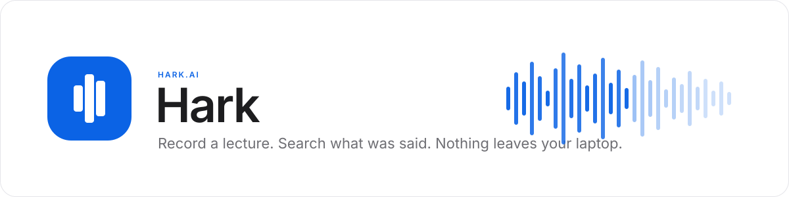
</p>

<p align="center">
  
  
  
  
  
  <a href="https://github.com/kennethyeaher/hark/actions/workflows/deploy.yml"></a>
  
</p>

<p align="center">
  <b><a href="https://kennethyeaher.github.io/hark/">Try Hark</a></b> &middot;
  <a href="#design">Design</a> &middot;
  <a href="#how-the-machine-learning-works">How the ML works</a> &middot;
  <a href="#run-locally">Run locally</a> &middot;
  <a href="#verification">Verification</a>
</p>

> **Status: in development.** Hark is my final project for INST360 at the University of Maryland. The design is finished. The app is being built in the order shown in the [roadmap](#roadmap), and this README only claims what is checked off there.

---

## The problem

Students record lectures and almost never listen to them again. An hour of audio is a bad place to look for the five minutes you need before an exam. Transcription services fix the search problem but ask you to upload a professor's voice, and your classmates' questions, to someone else's server.

Hark turns a recording into a searchable, timestamped transcript with a short summary, and does all of it inside the browser tab. No account, no upload, no server.

## What Hark does

| Feature | How it works | Status |
|---|---|---|
| Upload or record a lecture | Drop an mp3, wav, or m4a file, or record with the microphone | Planned |
| Transcribe on your device | Whisper runs in a Web Worker through Transformers.js | Planned |
| Timestamped transcript | Click any line to jump the player to that second | Planned |
| Find in transcript | Keyword search with highlighted matches | Planned |
| Semantic search across lectures | A sentence embedding model finds the passage even when the words differ | Planned |
| Summary and key points | A small summarization model writes three to five points you can tick off | Planned |
| Notes and moments | Write notes next to the transcript and flag moments with a color | Planned |
| Course colors | Every course owns a color that repeats on cards, folders, rows, and chips | Planned |
| Export | Markdown, plain text, SRT captions, or everything as a zip | Planned |
| Works offline after first load | Models and recordings are cached in the browser | Planned |

**Boundaries are deliberate.** Hark never sends audio or text anywhere. There is no login, no analytics, and no sync. If you clear the browser's site data, the recordings are gone, and the settings page will say so.

## A short walkthrough

1. Open Hark and click **New**.
2. Drop a lecture file onto the sheet, pick the course, and leave the model on **Balanced**.
3. Click **Start transcribing**. A progress card shows the model loading, the audio being transcribed, and the summary being written. You can keep using the library while it runs.
4. When it finishes, the recording page opens. The transcript sits in the middle, the summary and your notes sit on the right.
5. Type a phrase in **Find in transcript** to highlight matches, or use the search bar at the top to search every lecture you have.
6. Click a timestamp anywhere to hear that moment.

## Design

The interface follows the Library concept from the Figma file: a Google Drive style home with color coded courses, a Notion style recording page, and Apple system colors on a white background.

<p align="center">
  <a href="docs/screenshots/home.png">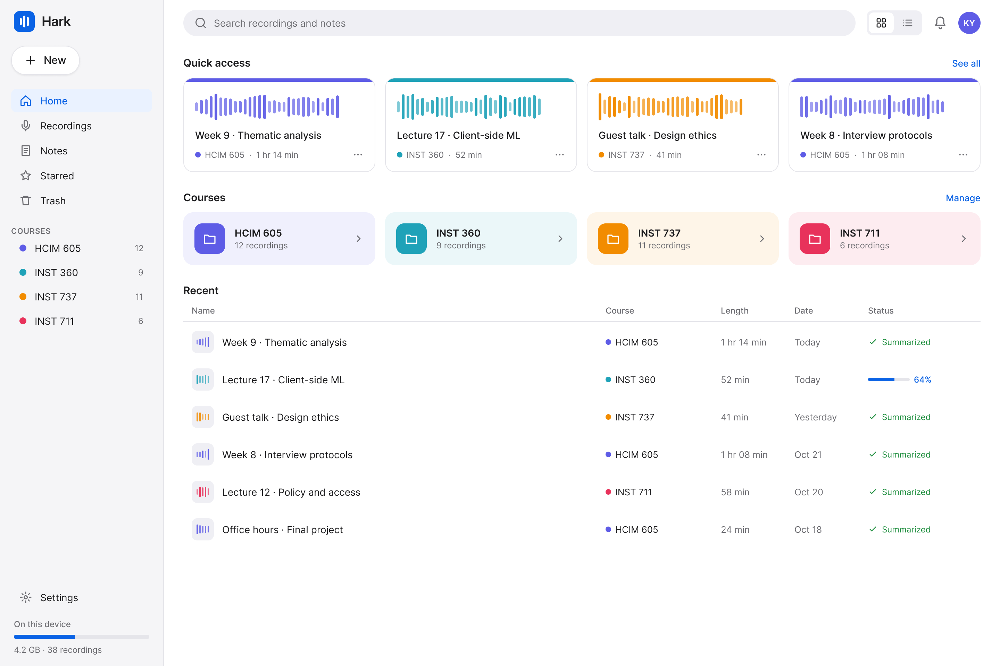</a>
</p>

<details>
<summary><b>See the recording page</b></summary>
<br>
<p align="center"><a href="docs/screenshots/recording.png">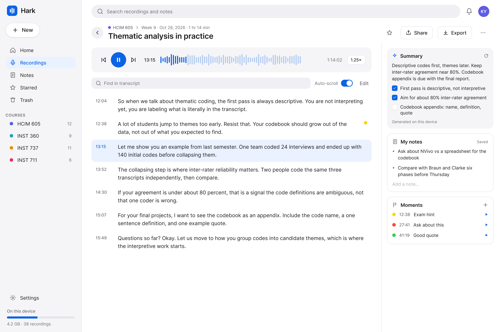</a></p>
</details>

<details>
<summary><b>See search, courses, the new recording sheet, and settings</b></summary>
<br>
<p align="center"><a href="docs/screenshots/search.png">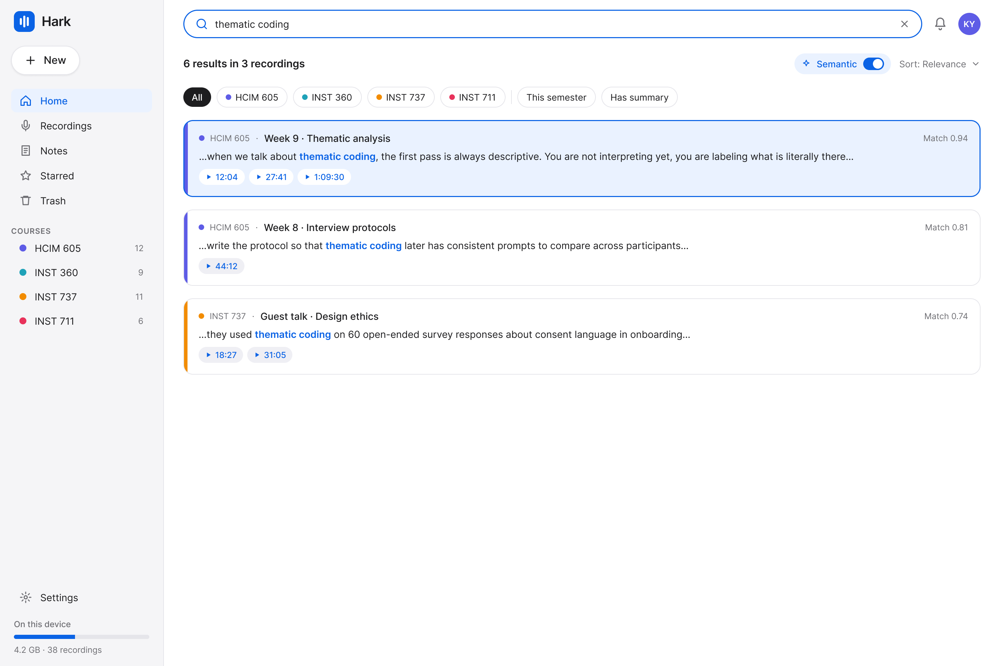</a></p>
<p align="center"><a href="docs/screenshots/course.png">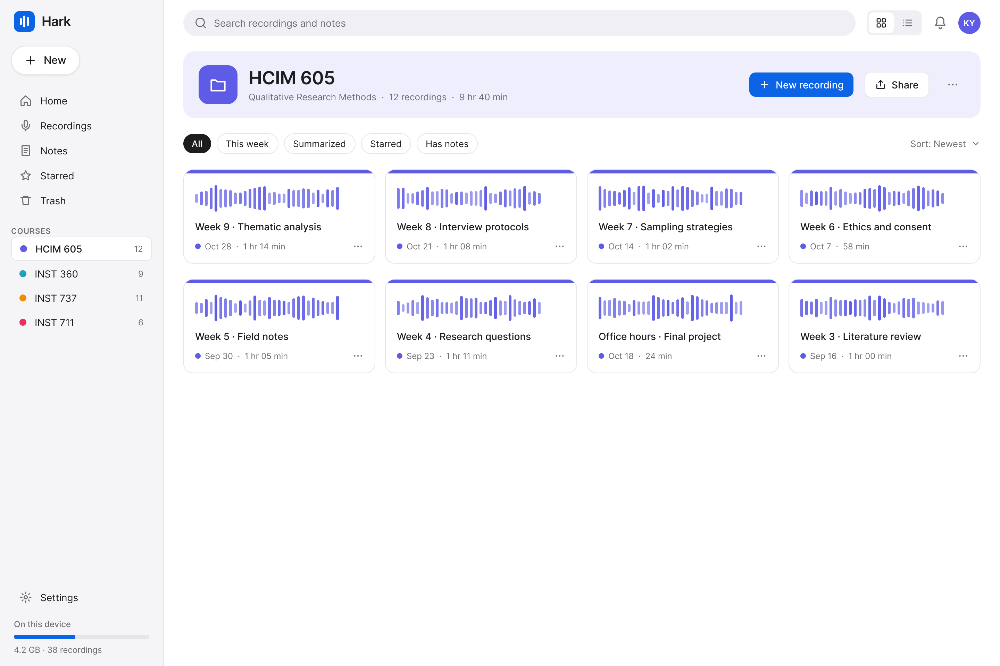</a></p>
<p align="center"><a href="docs/screenshots/new-recording.png">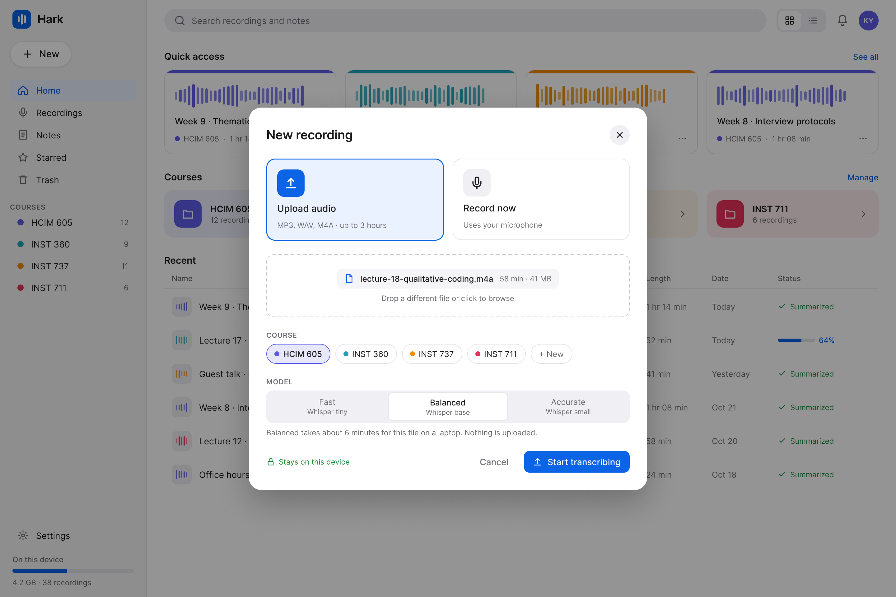</a></p>
<p align="center"><a href="docs/screenshots/settings.png">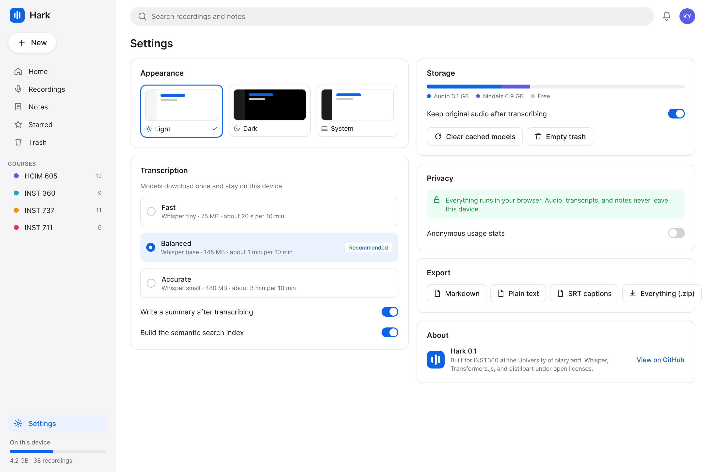</a></p>
</details>

<details>
<summary><b>See the design process</b></summary>
<br>
<p align="center"><a href="docs/screenshots/information-architecture.png">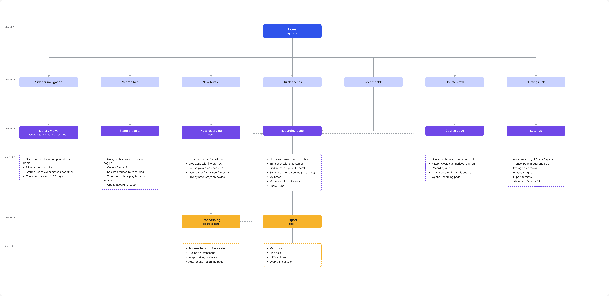</a></p>
<p align="center"><a href="docs/screenshots/process-inspiration.png">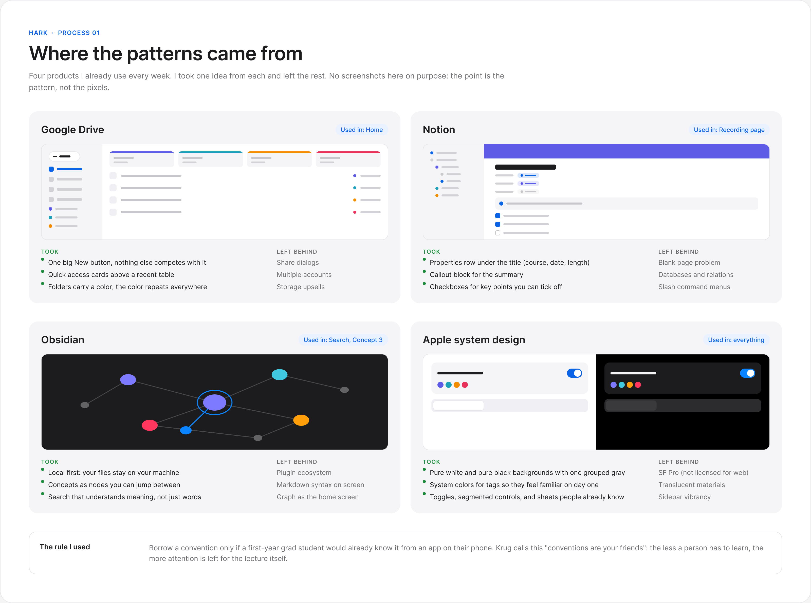</a></p>
<p align="center"><a href="docs/screenshots/process-decisions.png">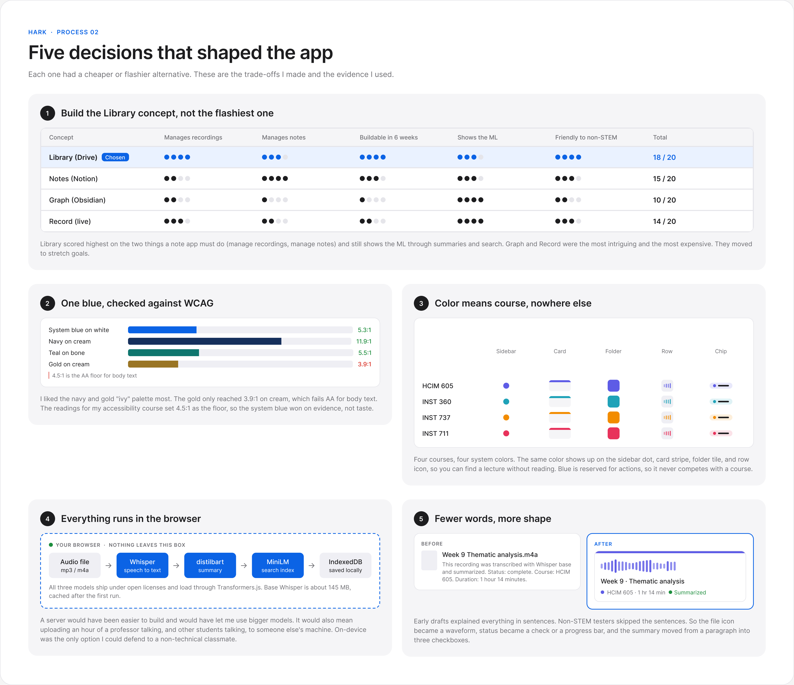</a></p>
<p align="center"><a href="docs/screenshots/process-naming.png">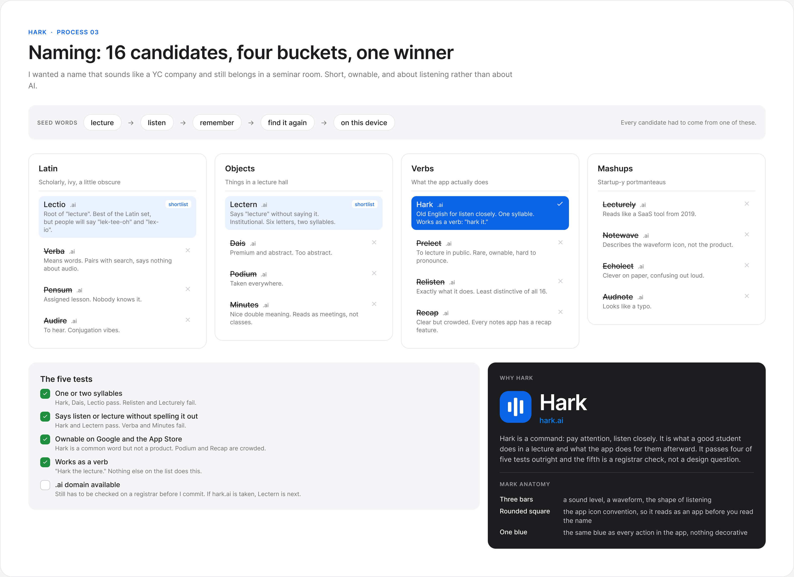</a></p>
</details>

Full file with four mock directions, a branding board, a clickable prototype, and the information architecture: [Figma](https://www.figma.com/design/IVA3ualHLLG2oKJXf85NlL/INST360-final).

## Design decisions

Most of the interface uses patterns from *Designing Interfaces* (Tidwell, Brewer, and Valencia, 3rd edition). Naming the pattern made it easier to decide what not to invent.

| Decision | Why | Pattern |
|---|---|---|
| One sidebar and top bar on every page | A student should never wonder where they are | Visual Framework |
| Transcript takes the center of the recording page, tools sit beside it | The transcript is the content; everything else supports it | Center Stage |
| Recordings shown as equal cards with a waveform | A waveform says "audio" faster than a file icon, and equal cards invite scanning | Grid of Equals, Cards |
| Home split into Quick access, Courses, Recent | Three clearly labeled areas beat one long list | Titled Sections |
| Search results on the left, matching transcript on the right | You never lose the source of a match | Two-Panel Selector |
| Filter chips on course and search pages | Narrow the set without leaving the page | Dynamic Queries |
| Recent table sorts by name, course, length, date | Expected behavior for anything that looks like a table | Sortable Table |
| One blue Start button on the new recording sheet | The next step should be obvious | Prominent Done Button |
| Balanced model preselected | Most people should not have to choose a model | Good Defaults and Smart Prefills |
| Progress card with named steps and a cancel action | Transcription takes minutes; people need to know it is working and that they can stop it | Progress Indicator, Cancelability |
| Drop zone text explains accepted formats | Say what will work before the user tries | Input Hints |

Two decisions came from accessibility readings rather than the pattern book. The label, secondary label, and blue action colors meet the WCAG 4.5:1 contrast floor on white and on the grouped gray, which is why the app uses a system blue instead of the navy and gold palette I liked more. The first course colors did not all pass, so each course and status color now has two values. The text value meets 4.5:1 and is the only one used for colored text. The shape value meets the 3:1 floor for graphics and colors dots, stripes, folder tiles, and waveforms. A unit test checks every pair against both surfaces. And every control will work from the keyboard, since the transcript itself is the accessibility case for the product.

## How the machine learning works

Everything below runs in the browser through [Transformers.js](https://github.com/huggingface/transformers.js). Models download once from the Hugging Face Hub and are cached by the browser.

| Step | Model | Size | Runs in |
|---|---|---|---|
| Speech to text | `onnx-community/whisper-base` (Fast: tiny, Accurate: small) | about 145 MB | Web Worker |
| Summary and key points | `Xenova/distilbart-cnn-6-6` | about 300 MB | Web Worker |
| Semantic search | `Xenova/all-MiniLM-L6-v2` sentence embeddings, cosine similarity in plain JavaScript | about 23 MB | Web Worker |
| Storage | IndexedDB through `idb` | | Main thread |

Whisper, BART, and MiniLM are released under open licenses. Hark does not fine tune or retrain anything. The honest limits: a one hour lecture takes a few minutes on a recent laptop, longer on an older one, and the summary model works best on clear speech from one speaker.

## Privacy

Audio, transcripts, notes, and embeddings live in the browser's IndexedDB for the site. Nothing is sent to a server, including Hark's own hosting, which only serves static files. Clearing site data deletes everything. The settings page will show what is stored and let you remove it.

## Class requirements

The routes below are the plan. The [roadmap](#roadmap) shows which ones exist so far.

| Requirement | Where it is met |
|---|---|
| Web app built with HTML, CSS, and JavaScript | Vite project, vanilla JavaScript modules, no UI framework |
| Uses a free or open source AI or ML model | Whisper, DistilBART, and MiniLM through Transformers.js |
| Home page | `/` library with quick access, courses, and recent recordings |
| Transcribe page | `/recording/:id` player and transcript |
| Search page | `/search` keyword and semantic search across lectures |
| Library page | `/course/:id` and the Recordings, Notes, Starred, and Trash views |
| About page | `/settings` with the about section, models used, and privacy note |

## Run locally

Requires Node 22 or newer.

```bash
git clone https://github.com/kennethyeaher/hark.git
cd hark
npm install
npm run dev
```

Open the printed local URL. The first transcription downloads the model, so expect a short wait on first use.

```bash
npm run build      # production build to dist/
npm run preview    # serve the production build
```

## Verification

```bash
npm test           # unit tests with Vitest
npm run lint       # ESLint
npm run format     # Prettier check
```

Right now the suite is one smoke test that mounts the app shell. The table lists the checks each feature will ship with.

| Area | How it is checked |
|---|---|
| Transcript segmentation and timestamps | Unit tests on the segment builder with fixture output from Whisper |
| Search ranking | Unit tests on keyword matching and cosine similarity against known vectors |
| Storage | Unit tests against a fake IndexedDB |
| Keyboard and contrast | Manual pass with the browser's accessibility tree and a contrast checker |

Automated checks do not prove full accessibility conformance. Screen reader testing has not started. When it does, it will cover VoiceOver in Safari and Chrome on macOS only.

## Project structure

```
hark/
├── index.html                 # single html entry
├── vite.config.js             # base path for github pages
├── eslint.config.js           # lint rules for browser, worker, and test code
├── .prettierrc                # formatting rules
├── .prettierignore
├── .gitignore
├── package.json               # scripts and dependencies
├── package-lock.json
├── src/
│   ├── main.js                # loads the styles and mounts the app
│   ├── app/
│   │   └── app.js             # app shell, a placeholder for now
│   └── styles/                # design tokens, base styles, components
├── tests/
│   └── smoke.test.js          # checks that the app shell mounts
├── docs/
│   ├── assets/                # banner
│   ├── screenshots/           # exported figma screens and process boards
│   └── design-patterns.md     # pattern references from designing interfaces
├── .github/workflows/         # build and deploy to github pages
├── LICENSE
└── README.md
```

Folders for pages, ui components, ml workers, and indexeddb access arrive with the milestones in the roadmap.

## Roadmap

- [ ] Project setup, tokens, and the app shell
- [ ] Home, course, and library views with sample data
- [ ] IndexedDB storage for recordings, notes, and moments
- [ ] Transcription worker with Whisper and the progress card
- [ ] Recording page with player, transcript, and find in transcript
- [ ] Summary and key points
- [ ] Semantic search across lectures
- [ ] Notes, moments, and export
- [ ] Settings, dark mode, and keyboard pass
- [ ] Deploy to GitHub Pages

## Source and submission

Built for INST360 at the University of Maryland, College Park, Fall 2026. Design work lives in the [Figma file](https://www.figma.com/design/IVA3ualHLLG2oKJXf85NlL/INST360-final). Pattern references come from *Designing Interfaces*, 3rd edition, and *Don't Make Me Think, Revisited*. Accessibility targets follow WCAG 2.1 AA as covered in the course readings.

## Author

Kenneth Yeaher. MS in Human-Computer Interaction, University of Maryland. [kennethyeaher.github.io](https://kennethyeaher.github.io)
